This page goes through one frame of human Link in the order the game runs it, listing each place his position is moved or checked against the stage's collision. Code links point to the decomp at commit `c8fa8c9`.

## Terms

**Positions and state**

- **pos**: the point at Link's feet. **old.pos**: where pos was at the start of the frame.
- **Proc**: Link's current action, such as walking, falling or hanging. Each proc has a function that runs once per frame.
- **Mode**: a set of flags that comes with each proc. Several steps below turn on or off by these modes:
  - 0x2: a jump or fall
  - 0x40: hanging from a ledge
  - 0x4000: many special actions, for example ledge hangs, crawling forward, item gets, chests and door opens
  - 0x10000: ladders and vines

**Collision**

- **Face**: one collision triangle. Its normal points out of its front, away from the solid side, and **n.y** is the normal's vertical part.
- **Floor, wall and roof**: every face is one of the three, by n.y ([`c_bg_w.cpp`](https://github.com/zeldaret/tp/blob/c8fa8c9e2aab72cf4e5db0e5d1c84a9ea6ee6eb0/src/SSystem/SComponent/c_bg_w.cpp#L24-L45)):
  - floor: n.y >= 0.5
  - roof: n.y < -0.8
  - wall: anything in between
- **Circle**: for walls, Link's body is three horizontal circles at fixed heights above his feet, all centered on pos.
- **Slice** and **pusher**: the slice is where a wall face crosses a circle's height. The pusher is that slice moved one circle radius out from the wall.
- **Line check**: a line cast between two points that reports the nearest face it crosses.
- **Ground hit, roof hit, wall hit**: flags the collision code sets when Link stands on ground, has a roof within his height, or was pushed by a wall this frame.
- **CC push**: the push from touching another actor, such as a pot or an enemy.
- **CrrPos**: the routine that runs all of Link's level collision, steps [4](#4-line-check-pass-1) to [10](#10-line-down-check) ([`dBgS_Acch::CrrPos`](https://github.com/zeldaret/tp/blob/c8fa8c9e2aab72cf4e5db0e5d1c84a9ea6ee6eb0/src/d/d_bg_s_acch.cpp#L310-L463)).

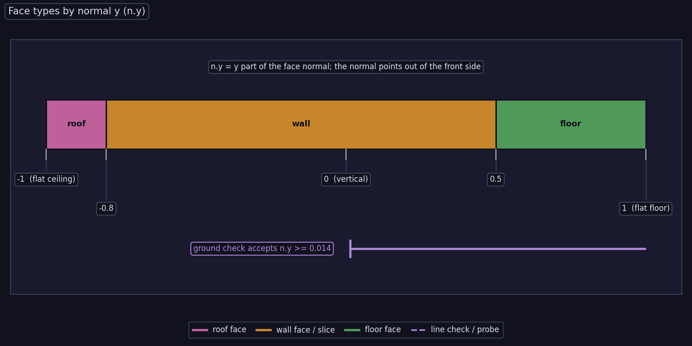

- The ground check (step [8](#8-ground-check)) uses its own, looser rule: any face with n.y >= 0.014 can be ground.

**Diagram colors:**

- green floors, orange walls, pink roofs, teal water
- blue for Link and his result, gray for earlier positions
- yellow arrows for movement (before to after), purple dashed lines for probes
- red for bad outcomes

## Summary

### Overview

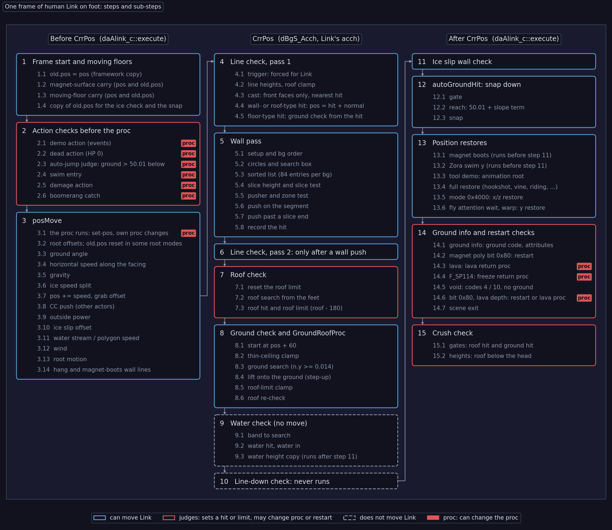

- Step [1.1](#1-frame-start-and-moving-platforms) is done by the actor framework. Steps [1.2](#1-frame-start-and-moving-platforms) to [3](#3-movement-posmove) and [11](#11-ice-slip-wall-check) to [15](#15-crush-check) run in Link's own `execute`. Steps [4](#4-line-check-pass-1) to [10](#10-line-down-check) run inside CrrPos ([called here](https://github.com/zeldaret/tp/blob/c8fa8c9e2aab72cf4e5db0e5d1c84a9ea6ee6eb0/src/d/actor/d_a_alink.cpp#L18160-L18161)).
- Three sub-steps run outside their numbered slot ([`execute`](https://github.com/zeldaret/tp/blob/c8fa8c9e2aab72cf4e5db0e5d1c84a9ea6ee6eb0/src/d/actor/d_a_alink.cpp#L18163-L18173)):
  - [13.1](#13-position-restores) and [13.2](#13-position-restores) run right after CrrPos, before step [11](#11-ice-slip-wall-check).
  - [9.3](#9-water-check) runs after step [11](#11-ice-slip-wall-check).

### Order

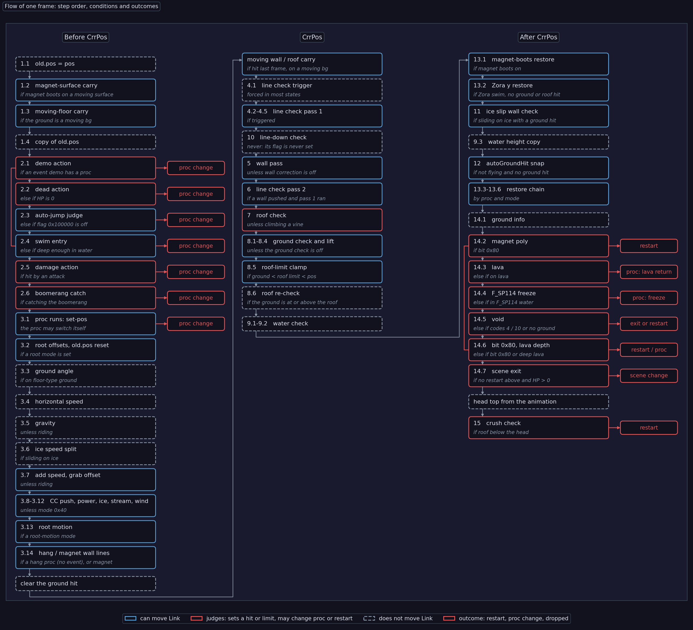

- Boxes run top to bottom. The italic line in a box says when that step runs.
- Red boxes on the right are outcomes: a proc change, a restart or a scene change.

### Values

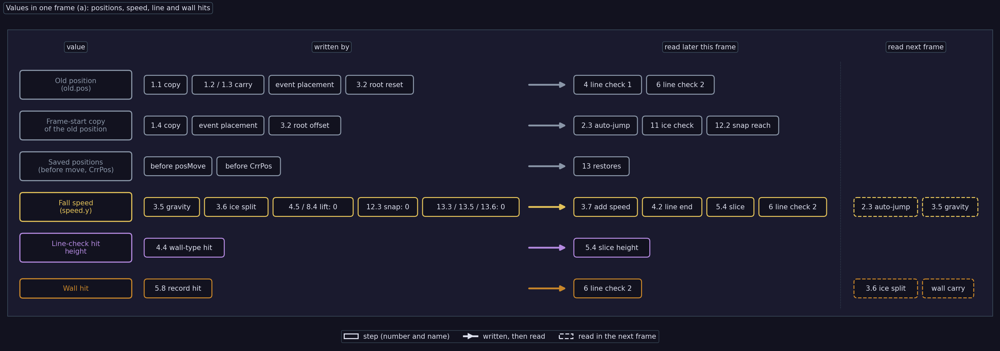

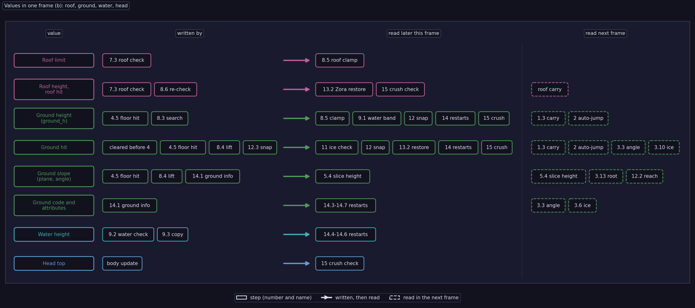

- Each row is one value: the steps that write it, the steps that read it later this frame, and the steps that read it next frame.
- **The wall pass and the ground slope:**
  - The wall pass (step [5](#5-wall-pass)) runs before this frame's ground check, so it cannot use this frame's slope.
  - Its slope term counts only if a ground check lifted Link onto the ground: either last frame's ground check, or a ground check this frame after a line check floor hit (step [4.5](#45-floor-hit)). Otherwise the term is 0, for example on the frame after a slope snap or in the air.
  - Code: [`GetWallAddY`](https://github.com/zeldaret/tp/blob/c8fa8c9e2aab72cf4e5db0e5d1c84a9ea6ee6eb0/src/d/d_bg_s_acch.cpp#L598-L612), [lift](https://github.com/zeldaret/tp/blob/c8fa8c9e2aab72cf4e5db0e5d1c84a9ea6ee6eb0/src/d/d_bg_s_acch.cpp#L163-L175), [cleared each frame](https://github.com/zeldaret/tp/blob/c8fa8c9e2aab72cf4e5db0e5d1c84a9ea6ee6eb0/src/d/d_bg_s_acch.cpp#L398-L400).

### Proc changes

These are the only steps that can switch Link to a new proc. The overview tags each of them.

- **[2.1](#21-demo-action) to [2.6](#25-to-26-damage-and-boomerang-catch)**: the action checks before the proc runs.
- **[3.1](#31-the-proc-runs)**: the proc itself, for example landing from a fall or starting a slide.
- **[14.3](#14-restart-checks), [14.4](#14-restart-checks) and [14.6](#14-restart-checks)**: the lava return and the freeze return start their own procs.
- **Restarts and exits** do not change the proc in the frame they fire. They set a cutscene ("demo") mode and reload the room or change the scene ([`startRestartRoom`](https://github.com/zeldaret/tp/blob/c8fa8c9e2aab72cf4e5db0e5d1c84a9ea6ee6eb0/src/d/actor/d_a_alink.cpp#L13478-L13517)).
- **On a later frame**, [2.1](#21-demo-action) can start a proc for some of those demo modes ([`checkDemoAction`](https://github.com/zeldaret/tp/blob/c8fa8c9e2aab72cf4e5db0e5d1c84a9ea6ee6eb0/src/d/actor/d_a_alink_demo.inc#L406-L483)):
  - a fall for the ground-code-5 exit
  - in some states, a next action after a restart

## 1. Frame Start and Moving Platforms

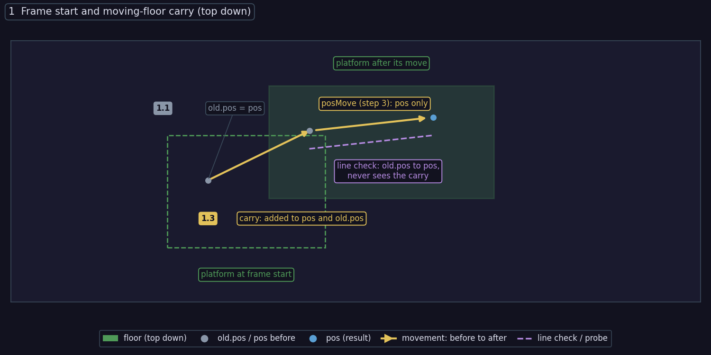

- **1.1** The framework copies pos into old.pos before Link's code runs ([`f_op_actor.cpp`](https://github.com/zeldaret/tp/blob/c8fa8c9e2aab72cf4e5db0e5d1c84a9ea6ee6eb0/src/f_op/f_op_actor.cpp#L331)).
- **1.2 to 1.3** If Link stood on a moving platform last frame (or, with magnet boots, a moving magnetic surface), its motion is added to both pos and old.pos. A few states, such as hookshot flight, skip this ([`execute`](https://github.com/zeldaret/tp/blob/c8fa8c9e2aab72cf4e5db0e5d1c84a9ea6ee6eb0/src/d/actor/d_a_alink.cpp#L17726-L17770)).
- **1.4** A copy of old.pos is saved for steps [11](#11-ice-slip-wall-check) and [12](#12-snap-down-autogroundhit) ([`execute`](https://github.com/zeldaret/tp/blob/c8fa8c9e2aab72cf4e5db0e5d1c84a9ea6ee6eb0/src/d/actor/d_a_alink.cpp#L17772)).
- Because the carry moves both points, the line check (step [4](#4-line-check-pass-1)) never sees it. Only the one-sided wall pass (step [5](#5-wall-pass)) can stop a platform from carrying Link into a wall.

## 2. Action Checks Before the Proc

Before the proc runs, a chain of checks can switch it ([`execute`](https://github.com/zeldaret/tp/blob/c8fa8c9e2aab72cf4e5db0e5d1c84a9ea6ee6eb0/src/d/actor/d_a_alink.cpp#L18086-L18098)).

- The whole step is skipped in special demo modes and during a clothes change.
- [2.1](#21-demo-action) to [2.4](#24-swim-entry) are one chain: once one of them acts, the rest are skipped. [2.3](#23-auto-jump-judge) and [2.4](#24-swim-entry) are also skipped while a cutscene proc started by [2.1](#21-demo-action) is active.
- [2.5](#25-to-26-damage-and-boomerang-catch) and [2.6](#25-to-26-damage-and-boomerang-catch) always run.

### 2.1 Demo Action

- Starts the proc an event or cutscene asks for ([`checkDemoAction`](https://github.com/zeldaret/tp/blob/c8fa8c9e2aab72cf4e5db0e5d1c84a9ea6ee6eb0/src/d/actor/d_a_alink_demo.inc#L71-L486)).
- Most of these wait until Link is on the ground ([early return](https://github.com/zeldaret/tp/blob/c8fa8c9e2aab72cf4e5db0e5d1c84a9ea6ee6eb0/src/d/actor/d_a_alink_demo.inc#L95-L120)).

### 2.2 Dead Action

- At 0 HP with no event running, Link starts the death proc if he is on the ground or swimming. In the air he starts a fall instead ([`checkDeadAction`](https://github.com/zeldaret/tp/blob/c8fa8c9e2aab72cf4e5db0e5d1c84a9ea6ee6eb0/src/d/actor/d_a_alink_demo.inc#L1269-L1304)).

### 2.3 Auto-Jump Judge

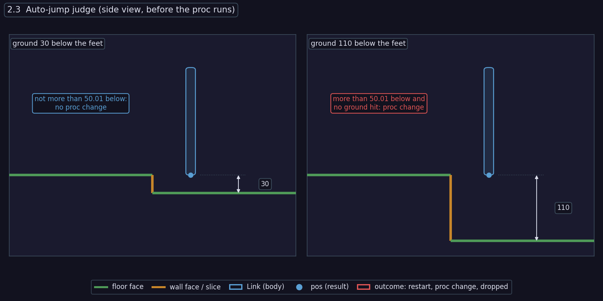

- **When:** Link had no ground hit last frame, and the ground is more than 50.01 below his feet ([`checkAutoJumpAction`](https://github.com/zeldaret/tp/blob/c8fa8c9e2aab72cf4e5db0e5d1c84a9ea6ee6eb0/src/d/actor/d_a_alink.cpp#L10733-L10747)).
  - It uses last frame's ground hit and ground height.
  - It is skipped while jumping, climbing, swimming or riding (mode mask 0x70C12), with magnet boots on, and in a few other states such as door opens and warps.
- **Result:**
  - Running fast with the stick held, facing the way he is moving: an auto jump.
  - At a ledge with a wall just below: a climb-down or a ledge hang.
  - Otherwise: a fall.
- Before switching the proc, it can also move Link ([source](https://github.com/zeldaret/tp/blob/c8fa8c9e2aab72cf4e5db0e5d1c84a9ea6ee6eb0/src/d/actor/d_a_alink.cpp#L10774-L10909)):
  - it raises pos.y by last frame's fall speed
  - it probes the ground and the wall below the edge
  - it can move Link sideways onto the edge it found, and nudges him along the wall's normal
- **Other branches** start a glide jump in an updraft, a roll jump, or a fall when magnet boots lose their surface ([source](https://github.com/zeldaret/tp/blob/c8fa8c9e2aab72cf4e5db0e5d1c84a9ea6ee6eb0/src/d/actor/d_a_alink.cpp#L10920-L10926)).
- Smaller drops are handled by the snap in step [12](#12-snap-down-autogroundhit).

### 2.4 Swim Entry

- If last frame's water check found water deep enough over Link's body, he starts a swim proc ([`checkSwimAction`](https://github.com/zeldaret/tp/blob/c8fa8c9e2aab72cf4e5db0e5d1c84a9ea6ee6eb0/src/d/actor/d_a_alink_swim.inc#L346-L493)).
- Landing in water from a jump also sets his height here ([source](https://github.com/zeldaret/tp/blob/c8fa8c9e2aab72cf4e5db0e5d1c84a9ea6ee6eb0/src/d/actor/d_a_alink_swim.inc#L422-L424)).

### 2.5 to 2.6 Damage and Boomerang Catch

- Taking a hit starts a damage proc ([`checkDamageAction`](https://github.com/zeldaret/tp/blob/c8fa8c9e2aab72cf4e5db0e5d1c84a9ea6ee6eb0/src/d/actor/d_a_alink_damage.inc#L376-L771)).
- Catching the boomerang starts the catch proc ([`checkBoomerangCatchAction`](https://github.com/zeldaret/tp/blob/c8fa8c9e2aab72cf4e5db0e5d1c84a9ea6ee6eb0/src/d/actor/d_a_alink_boom.inc#L333-L349)).

## 3. Movement (posMove)

All of the frame's movement is added to pos here, before any wall or floor is checked ([`posMove`](https://github.com/zeldaret/tp/blob/c8fa8c9e2aab72cf4e5db0e5d1c84a9ea6ee6eb0/src/d/actor/d_a_alink.cpp#L12908-L13293)).

### 3.1 The Proc Runs

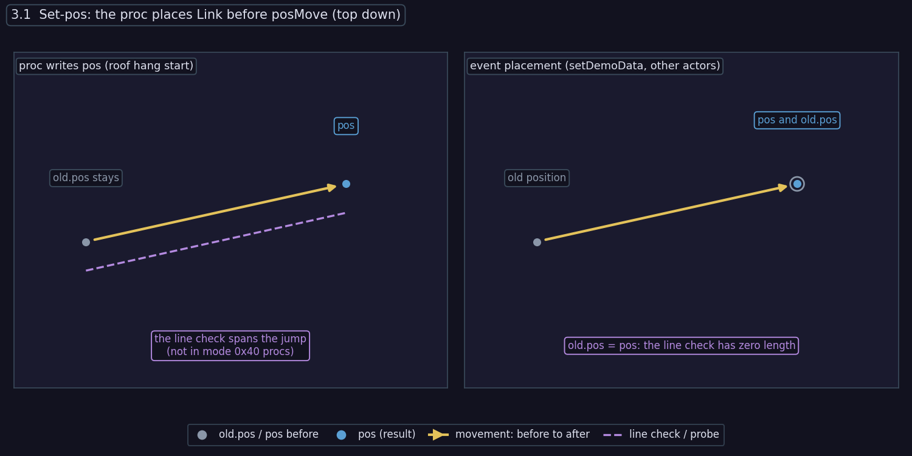

- The proc runs first and may place Link directly, for example at the start of a roof hang ([`execute`](https://github.com/zeldaret/tp/blob/c8fa8c9e2aab72cf4e5db0e5d1c84a9ea6ee6eb0/src/d/actor/d_a_alink.cpp#L18139)).
- Such a placement keeps old.pos, so the line check in step [4](#4-line-check-pass-1) covers the jump.
- Ledge grabs and hang starts are different. They put Link in mode 0x40, where:
  - the line check is off ([`commonProcInit`](https://github.com/zeldaret/tp/blob/c8fa8c9e2aab72cf4e5db0e5d1c84a9ea6ee6eb0/src/d/actor/d_a_alink.cpp#L15158-L15160))
  - step [3.2](#32-animation-offsets-and-the-oldpos-reset) also resets old.pos
- Event placements do not come from the proc: other actors or Link's cutscene code (before step [2](#2-action-checks-before-the-proc)) place him. They reset old.pos too, so that jump is never line-checked ([`setPlayerPosAndAngle`](https://github.com/zeldaret/tp/blob/c8fa8c9e2aab72cf4e5db0e5d1c84a9ea6ee6eb0/src/d/actor/d_a_alink.cpp#L9188-L9199)).

### 3.2 Animation Offsets and the old.pos Reset

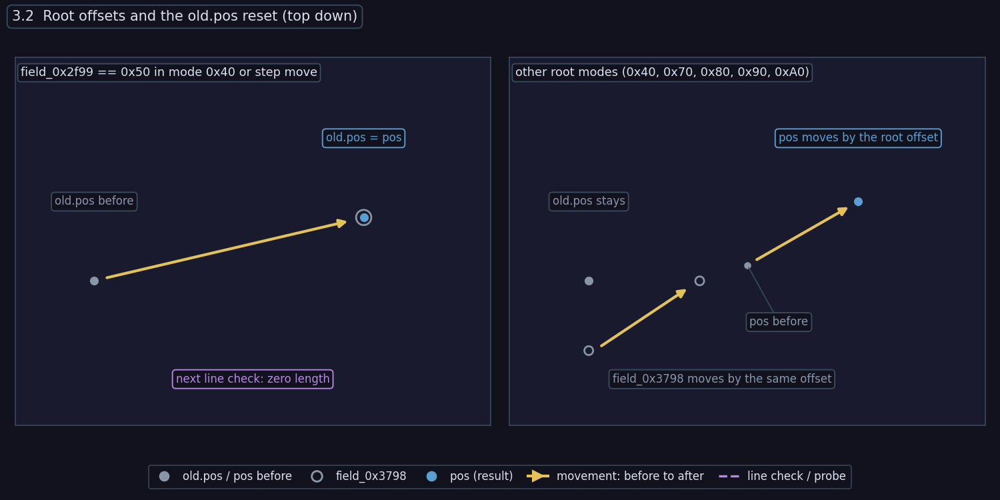

- **Root mode:** a value the proc sets that says how the animation's own movement is applied to pos.
- **Root mode 0x50**, in mode 0x40 or a step move, sets old.pos = pos. The next line check then has zero length ([`transAnimeProc`](https://github.com/zeldaret/tp/blob/c8fa8c9e2aab72cf4e5db0e5d1c84a9ea6ee6eb0/src/d/actor/d_a_alink.cpp#L12763-L12770)).
- **Other root modes** move pos by the animation's offset and leave old.pos alone ([source](https://github.com/zeldaret/tp/blob/c8fa8c9e2aab72cf4e5db0e5d1c84a9ea6ee6eb0/src/d/actor/d_a_alink.cpp#L12776-L12822)).
- **Root mode 0x70** also probes the ground and lifts Link onto it if he is below it ([source](https://github.com/zeldaret/tp/blob/c8fa8c9e2aab72cf4e5db0e5d1c84a9ea6ee6eb0/src/d/actor/d_a_alink.cpp#L12805-L12814)).

### 3.3 to 3.6 Slope, Speed, Gravity and Ice

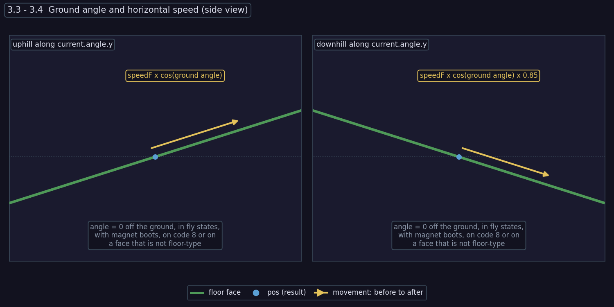

- **3.3 to 3.4 Speed** points along Link's movement angle (`current.angle.y`), scaled by the cosine of the slope under him ([`posMove`](https://github.com/zeldaret/tp/blob/c8fa8c9e2aab72cf4e5db0e5d1c84a9ea6ee6eb0/src/d/actor/d_a_alink.cpp#L12919-L12963)).
  - Uphill it is also scaled by 0.85.
  - The slope counts only with a ground hit on floor-type ground, outside jumps, climbs and riding.
- **3.5 Gravity** is -3.4 per frame, down to a fall speed of -200 ([`posMove`](https://github.com/zeldaret/tp/blob/c8fa8c9e2aab72cf4e5db0e5d1c84a9ea6ee6eb0/src/d/actor/d_a_alink.cpp#L13050-L13065)). Iron boots use 2.25 times the gravity and 1.5 times the limit.
- **3.6 Ice:** part of each speed change goes into a separate slip velocity ([`setIceSlipSpeed`](https://github.com/zeldaret/tp/blob/c8fa8c9e2aab72cf4e5db0e5d1c84a9ea6ee6eb0/src/d/actor/d_a_alink.cpp#L5259-L5302)). Link keeps sliding after he stops.

### 3.7 to 3.14 Moves Added to pos

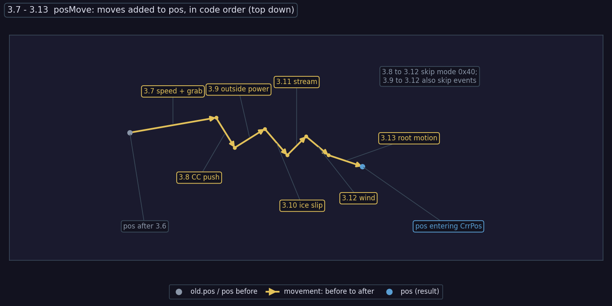

- The moves, in order ([`posMove`](https://github.com/zeldaret/tp/blob/c8fa8c9e2aab72cf4e5db0e5d1c84a9ea6ee6eb0/src/d/actor/d_a_alink.cpp#L13084-L13243)):
  1. speed and the grab offset
  2. the CC push
  3. outside power
  4. ice slip
  5. water stream
  6. wind
  7. animation root motion
- Some of them are skipped:
  - The CC push, outside power, ice slip, stream and wind are skipped while hanging (mode 0x40) and in some cutscene states.
  - Outside power, ice slip and wind are also skipped during events. The stream is too, except in events that allow it.
- **3.14** Hanging and magnet boots run their own small wall line checks ([source](https://github.com/zeldaret/tp/blob/c8fa8c9e2aab72cf4e5db0e5d1c84a9ea6ee6eb0/src/d/actor/d_a_alink.cpp#L13249-L13292)). Apart from those and the root mode 0x70 ground probe, posMove checks no collision.

## 4. Line Check, Pass 1

One line per circle, at that circle's height, from old.pos to pos ([`LineCheck`](https://github.com/zeldaret/tp/blob/c8fa8c9e2aab72cf4e5db0e5d1c84a9ea6ee6eb0/src/d/d_bg_s_acch.cpp#L209-L308)). This is the only check that stops a move through a wall within one frame, because the wall pass cannot pull back a center that ended behind a wall.

### 4.1 Trigger

- The line check runs when Link moved more than 35 sideways, dropped more than 9.99, or when it is forced ([`CrrPos`](https://github.com/zeldaret/tp/blob/c8fa8c9e2aab72cf4e5db0e5d1c84a9ea6ee6eb0/src/d/d_bg_s_acch.cpp#L360-L366)).
- Link forces it on every proc change, so every move is checked, even a 1-unit one ([`commonProcInit`](https://github.com/zeldaret/tp/blob/c8fa8c9e2aab72cf4e5db0e5d1c84a9ea6ee6eb0/src/d/actor/d_a_alink.cpp#L15158-L15163)).
- It is off:
  - while hanging (mode 0x40)
  - in step moves
  - on door open
  - in the fall after a ground-code-5 exit
- Only big moves are checked on chest open, in a boar-battle knockback and on the board.

### 4.2 Line Heights

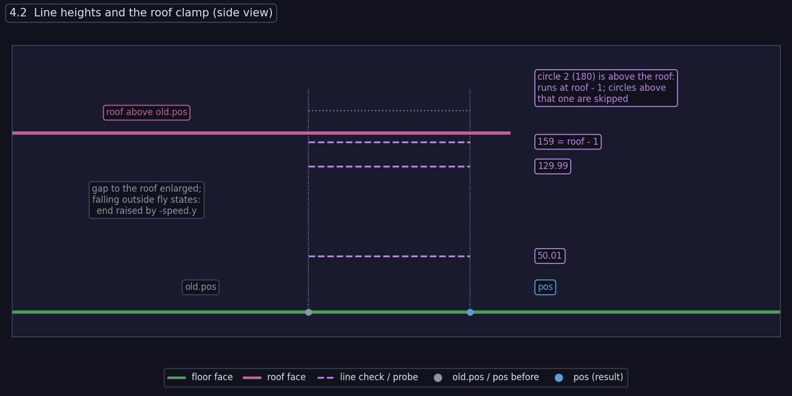

- The lines run at the circle heights, 50.01, 129.99 and 180 ([source](https://github.com/zeldaret/tp/blob/c8fa8c9e2aab72cf4e5db0e5d1c84a9ea6ee6eb0/src/d/d_bg_s_acch.cpp#L210-L251)).
- Under a low roof above old.pos:
  - the first line that would be above it runs 1 under the roof
  - the lines above that one are skipped
- When Link is falling outside jumps and climbs, the end of each line is raised by the fall speed. When gravity was the only vertical move, the line is level.

### 4.3 Front Faces Only

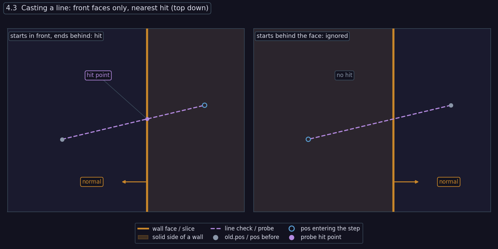

- A face counts only if the line starts in front of it and ends on or behind it. The nearest hit wins ([`dBgWKCol::LineCheck`](https://github.com/zeldaret/tp/blob/c8fa8c9e2aab72cf4e5db0e5d1c84a9ea6ee6eb0/src/d/d_bg_w_kcol.cpp#L427-L433)).
- With only three lines, a crack in the collision at exactly those heights lets a move through.

### 4.4 Wall or Roof Hit

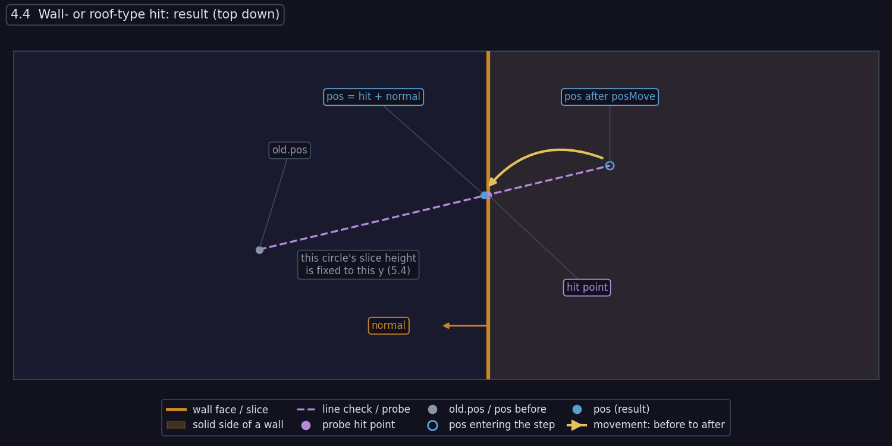

- Link is placed 1 unit out from the face, along its normal ([`LineCheck`](https://github.com/zeldaret/tp/blob/c8fa8c9e2aab72cf4e5db0e5d1c84a9ea6ee6eb0/src/d/d_bg_s_acch.cpp#L263-L272)).
- That circle's wall check in step [5](#5-wall-pass) is then pinned to this height.
- Later lines still start at old.pos but end at the new pos.
- If the roof-clamped line from [4.2](#42-line-heights) hits a wall, Link ends up lower than his old height. The code subtracts the circle's full height, not the clamped one ([clamp](https://github.com/zeldaret/tp/blob/c8fa8c9e2aab72cf4e5db0e5d1c84a9ea6ee6eb0/src/d/d_bg_s_acch.cpp#L229-L236), [subtraction](https://github.com/zeldaret/tp/blob/c8fa8c9e2aab72cf4e5db0e5d1c84a9ea6ee6eb0/src/d/d_bg_s_acch.cpp#L272)).

### 4.5 Floor Hit

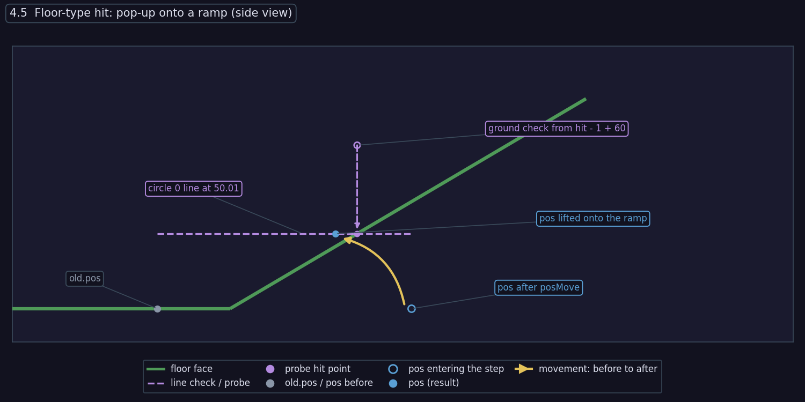

- Link is placed 1 unit under the hit, and a ground check runs from there. It lifts him onto the floor the line hit ([`LineCheck`](https://github.com/zeldaret/tp/blob/c8fa8c9e2aab72cf4e5db0e5d1c84a9ea6ee6eb0/src/d/d_bg_s_acch.cpp#L273-L276)).
- A hit by a high line can pop him up by up to that line's height.

## 5. Wall Pass

The wall pushers that hold Link's body away from walls ([`WallCorrectSort`](https://github.com/zeldaret/tp/blob/c8fa8c9e2aab72cf4e5db0e5d1c84a9ea6ee6eb0/src/d/d_bg_w_kcol.cpp#L1013-L1460)). See also [Wall Collisions and Correction](/posts/wall-correct-sort).

- **5.1** Skipped while wall correction is off: door open, chest open and a boar-battle knockback ([`CrrPos`](https://github.com/zeldaret/tp/blob/c8fa8c9e2aab72cf4e5db0e5d1c84a9ea6ee6eb0/src/d/d_bg_s_acch.cpp#L368-L374)).

### 5.2 Circles

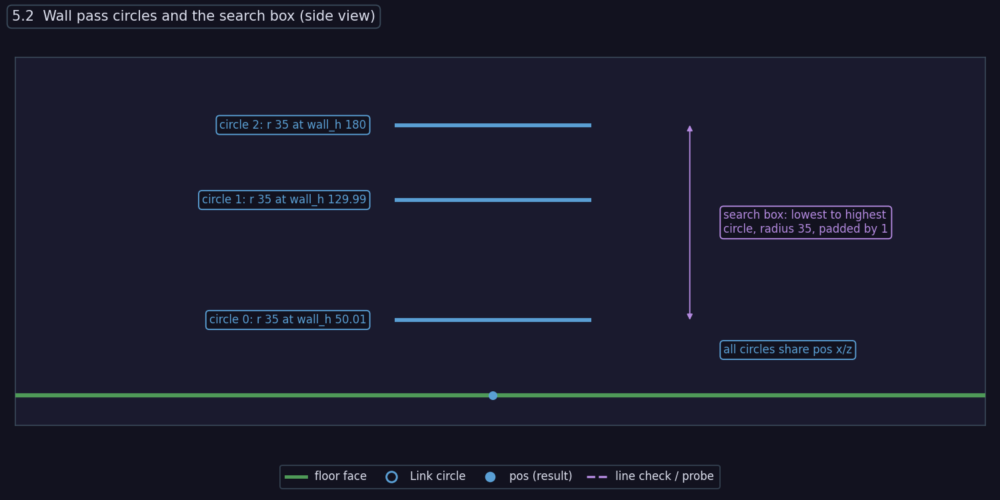

- By default there are three circles of radius 35 at 50.01, 129.99 and 180 above the feet, all sharing one center ([`playerInit`](https://github.com/zeldaret/tp/blob/c8fa8c9e2aab72cf4e5db0e5d1c84a9ea6ee6eb0/src/d/actor/d_a_alink.cpp#L4498-L4500)).
- Each proc change sets them again ([`setBgCheckParam`](https://github.com/zeldaret/tp/blob/c8fa8c9e2aab72cf4e5db0e5d1c84a9ea6ee6eb0/src/d/actor/d_a_alink.cpp#L8936-L9029)). Some states use other values, for example 25/25/25 while hanging from a ledge and 30/80/80 while crawling.

### 5.3 Sorted List

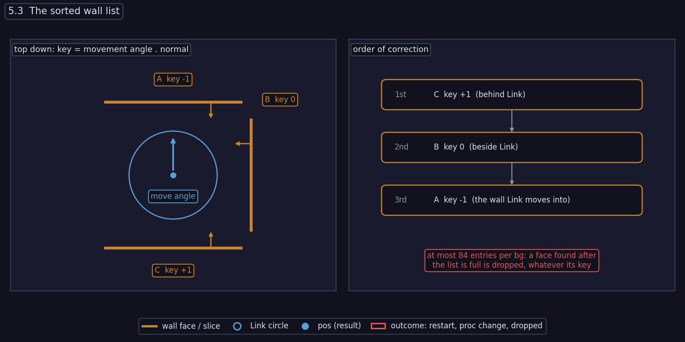

- Walls are sorted by the angle between Link's movement angle (`current.angle.y`) and the wall's normal. Walls behind him come first, then walls beside him, and the wall in front of him comes last, so its push is applied last ([`WallCorrectSort`](https://github.com/zeldaret/tp/blob/c8fa8c9e2aab72cf4e5db0e5d1c84a9ea6ee6eb0/src/d/d_bg_w_kcol.cpp#L1158-L1229)).
- The list holds at most 84 walls per collision source. Any wall found after it is full is dropped.

### 5.4 Slice Height and Slice Test

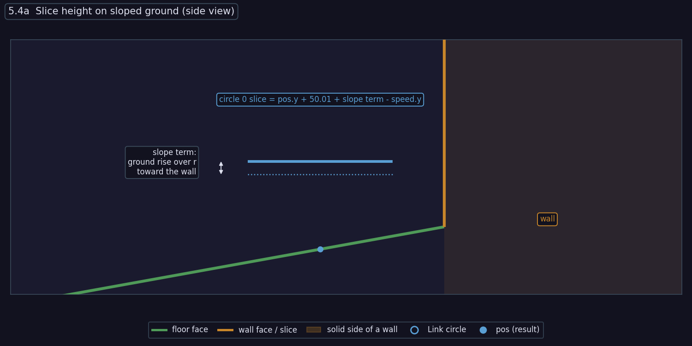

- Each circle tests walls at its own height, plus a slope term ([source](https://github.com/zeldaret/tp/blob/c8fa8c9e2aab72cf4e5db0e5d1c84a9ea6ee6eb0/src/d/d_bg_w_kcol.cpp#L1262-L1266)).
- The slope term raises the height by how much the ground rises toward the wall over one circle radius. It only counts after a ground check lifted Link (see [Values](#values)).
- The frame's fall is taken back out of the height, so when gravity was the only vertical move the slices sit at last frame's heights.

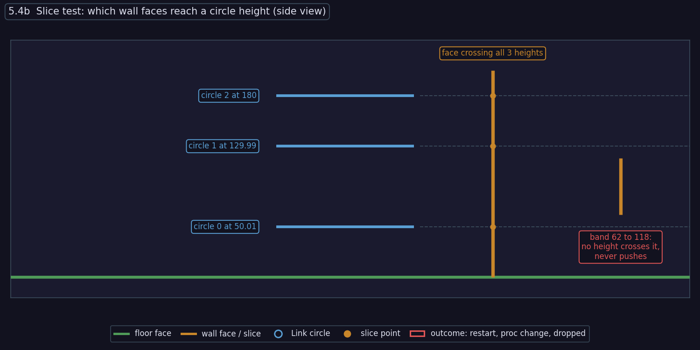

- A wall is tested only if it crosses that height ([source](https://github.com/zeldaret/tp/blob/c8fa8c9e2aab72cf4e5db0e5d1c84a9ea6ee6eb0/src/d/d_bg_w_kcol.cpp#L1267-L1291)).
- A wall band that lies entirely between two circle heights never pushes.

### 5.5 to 5.6 Push Zone

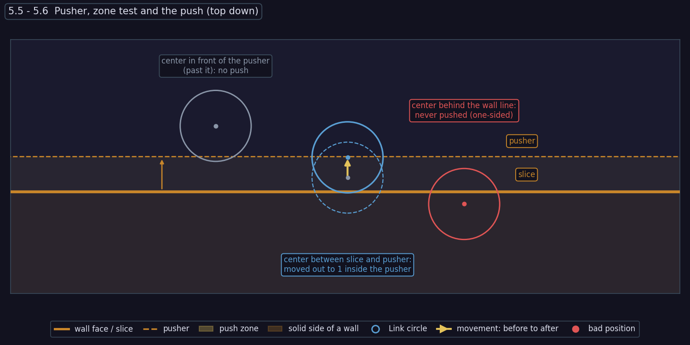

- A center between the wall and its pusher is pushed out to 1 unit inside the pusher, for a vertical wall ([`WallCorrectSort`](https://github.com/zeldaret/tp/blob/c8fa8c9e2aab72cf4e5db0e5d1c84a9ea6ee6eb0/src/d/d_bg_w_kcol.cpp#L1337-L1364)).
- A center behind the wall line is more than 35 from the pusher, so it is never pushed back out.
- The pusher sits about 35.0064 out instead of 35, which leaves the seam used by [displacement clipping](/posts/displacement-clipping).
- Pushes only move Link sideways.

### 5.7 Corners

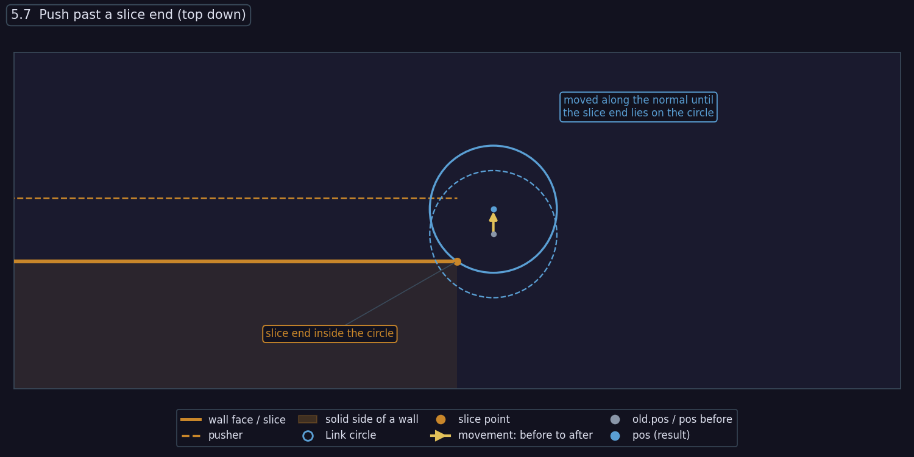

- Past the end of a wall, the circle is pushed along the wall's normal until the wall's end lies on it ([`WallCorrectSort`](https://github.com/zeldaret/tp/blob/c8fa8c9e2aab72cf4e5db0e5d1c84a9ea6ee6eb0/src/d/d_bg_w_kcol.cpp#L1377-L1449)).

## 6. Line Check, Pass 2

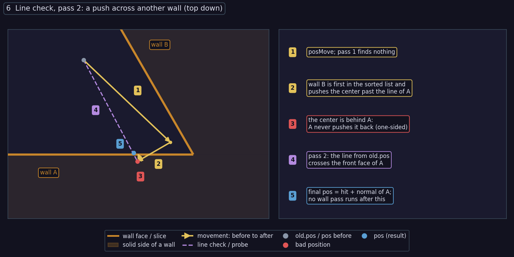

- The line check from old.pos runs again if pass 1 ran and a wall pushed Link ([`CrrPos`](https://github.com/zeldaret/tp/blob/c8fa8c9e2aab72cf4e5db0e5d1c84a9ea6ee6eb0/src/d/d_bg_s_acch.cpp#L376-L378)).
- This catches a corner push that carried Link across another wall.
- Nothing wall-corrects its result again this frame.

## 7. Roof Check

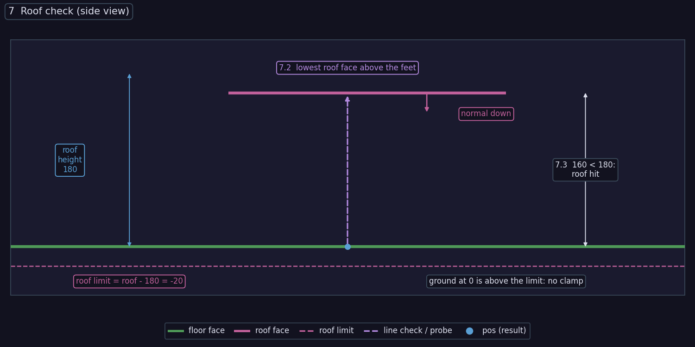

- The roof check finds the lowest roof face straight above the feet ([`CrrPos`](https://github.com/zeldaret/tp/blob/c8fa8c9e2aab72cf4e5db0e5d1c84a9ea6ee6eb0/src/d/d_bg_s_acch.cpp#L380-L396)).
- If that roof is less than 180 above the feet, Link has a roof hit and a roof limit 180 below the roof. The 180 is Link's height. Some states use other values, for example 80 on the spinner.
- It does not move Link. Steps [8](#8-ground-check) and [15](#15-crush-check) use its results.
- It is off on ladders and vines (mode 0x10000, [`commonProcInit`](https://github.com/zeldaret/tp/blob/c8fa8c9e2aab72cf4e5db0e5d1c84a9ea6ee6eb0/src/d/actor/d_a_alink.cpp#L15092-L15096)).

## 8. Ground Check

### 8.1 to 8.2 Start and Thin-Ceiling Clamp

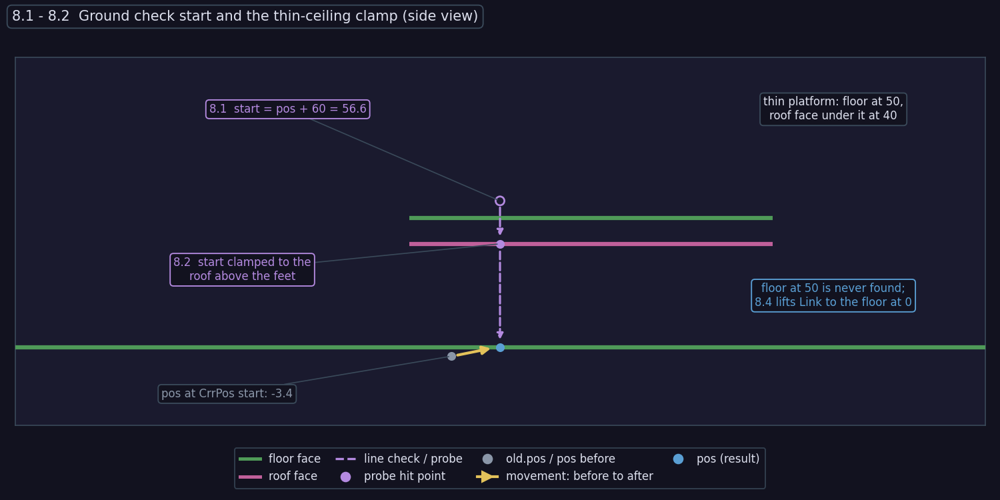

- The search starts 60 above the feet, lowered to any roof face directly above the feet ([`GroundCheck`](https://github.com/zeldaret/tp/blob/c8fa8c9e2aab72cf4e5db0e5d1c84a9ea6ee6eb0/src/d/d_bg_s_acch.cpp#L142-L157)).
- A roof face less than 60 above the feet hides every floor above it.

### 8.3 to 8.4 Search and Step-Up

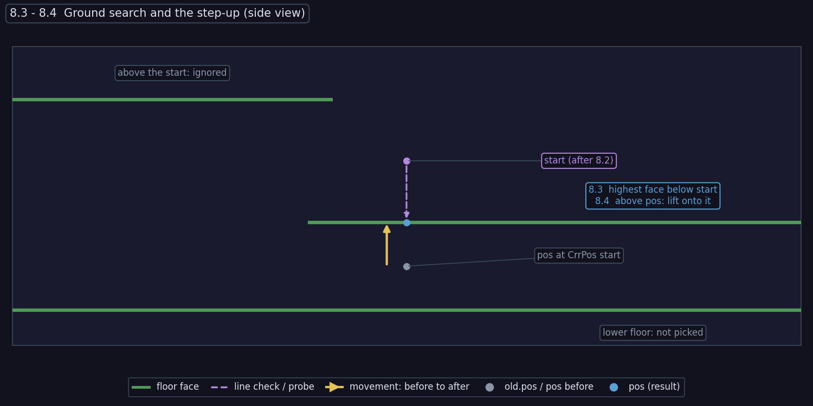

- The search takes the highest face below the start with n.y >= 0.014, so steep wall-type faces count as ground here ([`GroundCross`](https://github.com/zeldaret/tp/blob/c8fa8c9e2aab72cf4e5db0e5d1c84a9ea6ee6eb0/src/d/d_bg_w_kcol.cpp#L570-L587)).
- If that ground is above Link's height when CrrPos started, he is lifted onto it ([`GroundCheck`](https://github.com/zeldaret/tp/blob/c8fa8c9e2aab72cf4e5db0e5d1c84a9ea6ee6eb0/src/d/d_bg_s_acch.cpp#L163-L175)). The lift also:
  - sets the fall speed to 0
  - sets the ground hit
- The ground check never moves him down. That is left to gravity and the snap in step [12](#12-snap-down-autogroundhit).
- If ground is found but Link is not lifted, the ground height is still kept for steps [12](#12-snap-down-autogroundhit), [14](#14-restart-checks) and [15](#15-crush-check).

### 8.5 to 8.6 Roof-Limit Clamp

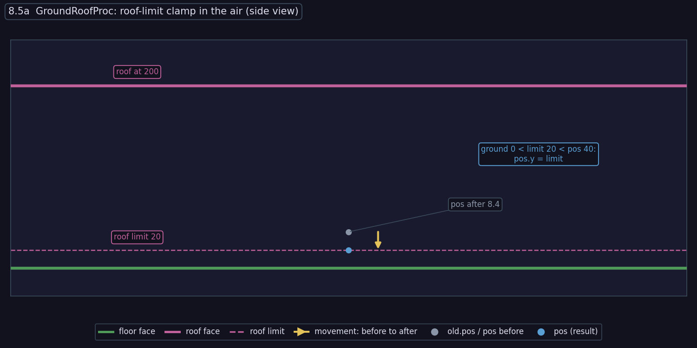

- If the ground is below the roof limit and Link is above the limit, he is lowered to the limit ([`GroundRoofProc`](https://github.com/zeldaret/tp/blob/c8fa8c9e2aab72cf4e5db0e5d1c84a9ea6ee6eb0/src/d/d_bg_s_acch.cpp#L193-L207)).
- **8.6 Roof re-check:** if the ground is at or above the roof, the roof is checked again from the new pos and the roof hit is cleared.

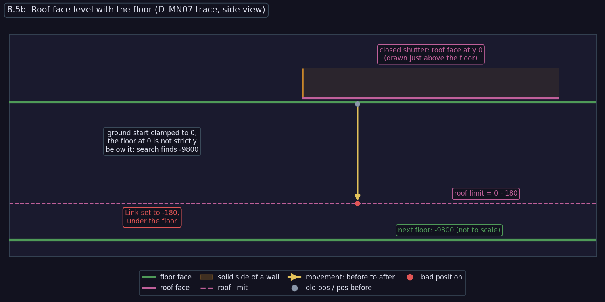

- A roof face level with a floor, such as a closed shutter, puts Link 180 under that floor:
  - The start clamp hides the floor at the roof's level.
  - The search finds a lower floor.
  - The roof limit then pulls Link down to 180 under the roof.

## 9. Water Check

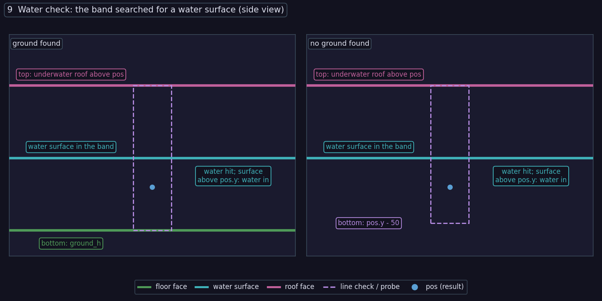

- The water check looks for a water surface between the ground (or 50 below the feet, with no ground) and the underwater roof above Link ([`CrrPos`](https://github.com/zeldaret/tp/blob/c8fa8c9e2aab72cf4e5db0e5d1c84a9ea6ee6eb0/src/d/d_bg_s_acch.cpp#L408-L453)). It never moves him.
- **9.3 Copy:** the water height is copied for later steps after step [11](#11-ice-slip-wall-check) ([`setWaterY`](https://github.com/zeldaret/tp/blob/c8fa8c9e2aab72cf4e5db0e5d1c84a9ea6ee6eb0/src/d/actor/d_a_alink.cpp#L8860-L8873)).
- The restart checks read it this frame, and the swim entry ([2.4](#24-swim-entry)) reads it next frame.

## 10. Line-Down Check

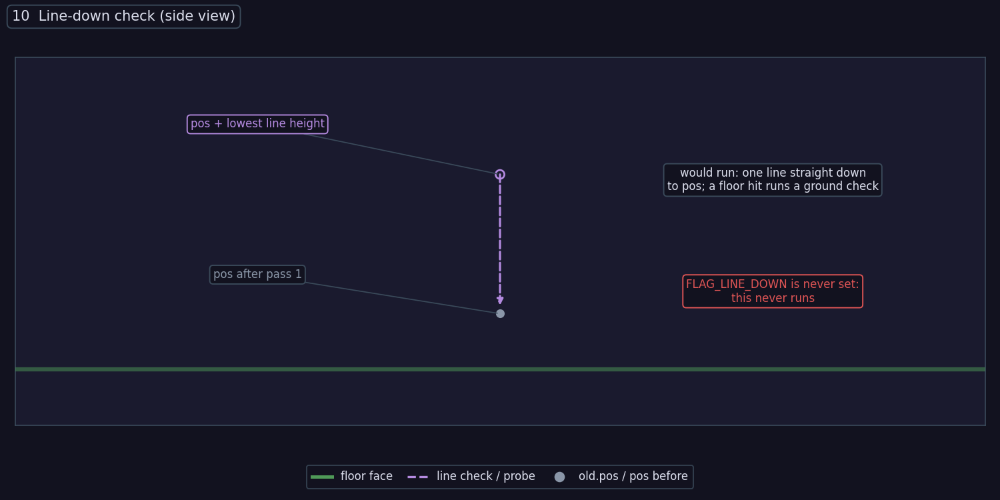

- A downward line exists in the code, but nothing ever sets its flag, so it never runs ([`LineCheck`](https://github.com/zeldaret/tp/blob/c8fa8c9e2aab72cf4e5db0e5d1c84a9ea6ee6eb0/src/d/d_bg_s_acch.cpp#L281-L307)).

## 11. Ice Slip Wall Check

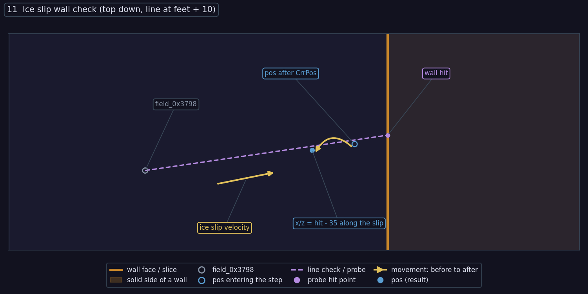

- This runs when Link is sliding on ice with a ground hit ([`iceSlipBgCheck`](https://github.com/zeldaret/tp/blob/c8fa8c9e2aab72cf4e5db0e5d1c84a9ea6ee6eb0/src/d/actor/d_a_alink.cpp#L5232-L5257)).
- It casts one line at feet height + 10, from the saved frame-start position past pos, extended 35 along the slide.
- On a wall hit, Link stops 35 short of the wall along the slide. Nothing wall-corrects this again.

## 12. Snap Down (autoGroundHit)

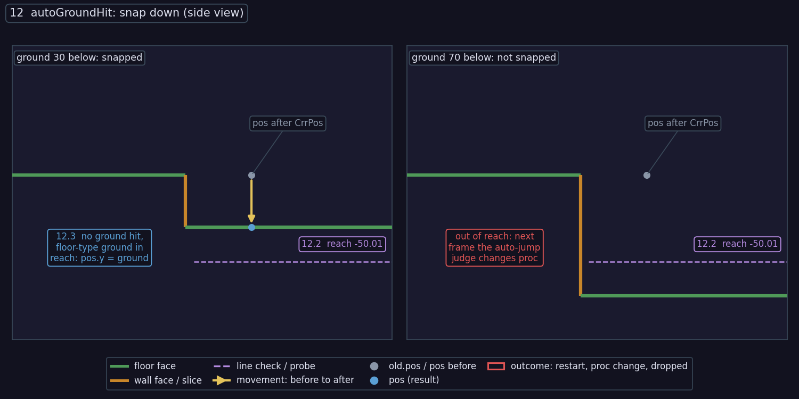

- This runs when Link has no ground hit after CrrPos and is not jumping, climbing, swimming or riding. Ledge hangs still snap ([`autoGroundHit`](https://github.com/zeldaret/tp/blob/c8fa8c9e2aab72cf4e5db0e5d1c84a9ea6ee6eb0/src/d/actor/d_a_alink.cpp#L13341-L13382)).
- If floor-type ground lies up to 50.01 below him, he is snapped down onto it, which keeps him on stairs and slopes. The reach grows when he moves downhill.
- A bigger drop leaves him in the air, and the auto-jump judge ([2.3](#23-auto-jump-judge)) handles it next frame.

## 13. Position Restores

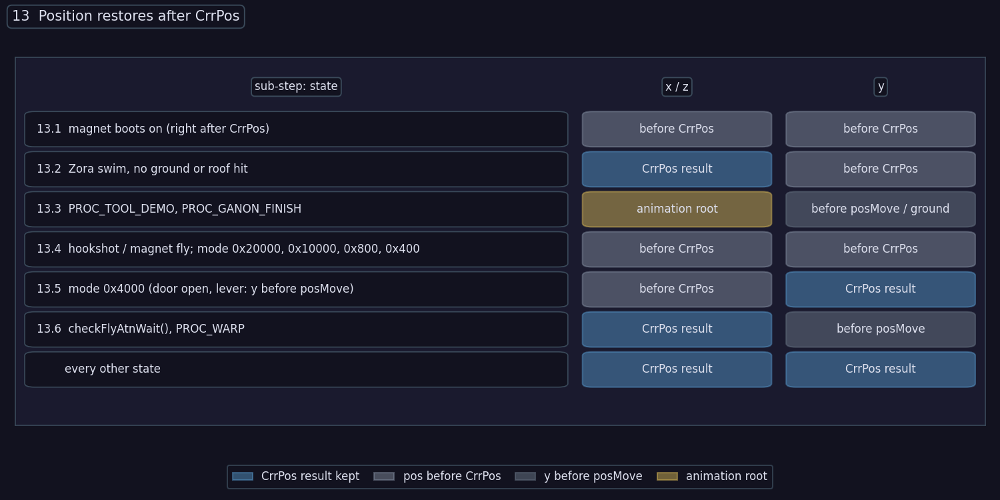

- Some states throw the collision result away and use a position saved earlier ([`execute`](https://github.com/zeldaret/tp/blob/c8fa8c9e2aab72cf4e5db0e5d1c84a9ea6ee6eb0/src/d/actor/d_a_alink.cpp#L18194-L18229)).
- 13.1 (magnet boots) and 13.2 (Zora swim) run right after CrrPos, before step [11](#11-ice-slip-wall-check) ([source](https://github.com/zeldaret/tp/blob/c8fa8c9e2aab72cf4e5db0e5d1c84a9ea6ee6eb0/src/d/actor/d_a_alink.cpp#L18163-L18169)).
- Mode 0x4000 keeps the x/z from before collision but the new y. Examples are ledge hangs, crawling forward, item gets, chests and door opens, but not crawl start, end or auto move. Any sideways drift in those states passes through walls.

## 14. Restart Checks

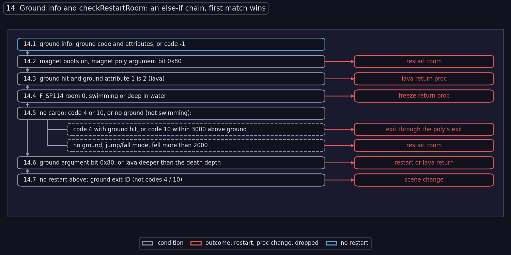

- The checks are an else-if chain where the first match wins ([`checkRestartRoom`](https://github.com/zeldaret/tp/blob/c8fa8c9e2aab72cf4e5db0e5d1c84a9ea6ee6eb0/src/d/actor/d_a_alink.cpp#L13557-L13658)).
- The chain runs every frame, even at 0 HP. Only the scene exit after it also needs HP above 0 ([`execute`](https://github.com/zeldaret/tp/blob/c8fa8c9e2aab72cf4e5db0e5d1c84a9ea6ee6eb0/src/d/actor/d_a_alink.cpp#L18255-L18257)).
- Lava ground starts the lava return.
- Ground codes 4 and 10 exit through the floor's exit:
  - Code 4 exits on landing on it, while swimming above it, or after a long fall over it.
  - Code 10 exits within 3000 above it.
- With no ground at all, Link voids only after falling more than 2000 below his jump start in a jump or fall, and only with no water below. The limit is 3000 in F_SP114 and 1000 in the boar battle.

## 15. Crush Check

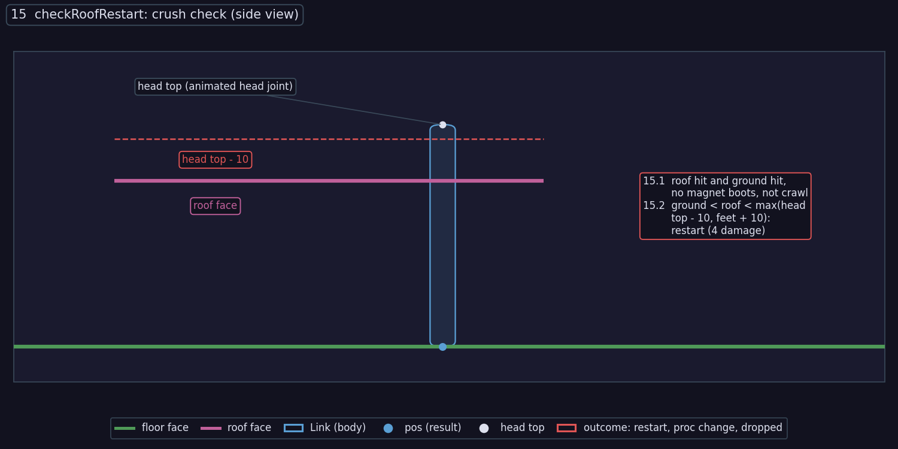

- With a roof hit and a ground hit, a roof below Link's head top minus 10 voids him with 4 damage ([`checkRoofRestart`](https://github.com/zeldaret/tp/blob/c8fa8c9e2aab72cf4e5db0e5d1c84a9ea6ee6eb0/src/d/actor/d_a_alink.cpp#L13524-L13555)).
- It does not fire with magnet boots, at the start or end of a crawl, in the coach escort game, or under two specific moving objects (`OBJ_SO` and `Obj_SCannon`).
- The head height comes from the animation, so crouching lowers the threshold.
- [8.6](#85-to-86-roof-limit-clamp) clears the roof hit, so the crush check never fires after that re-check.
